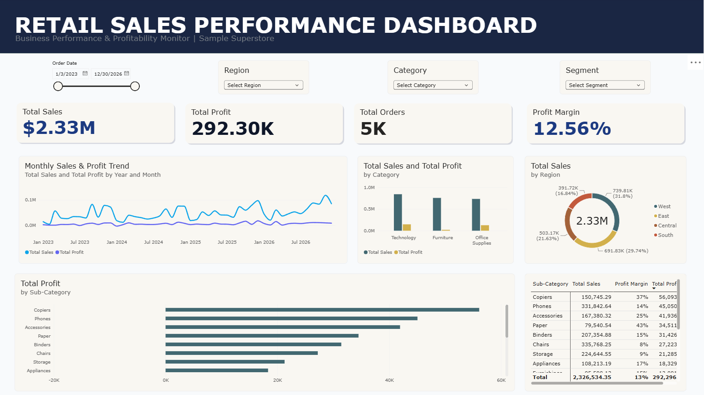

# Retail Sales Performance Dashboard

## Overview
An interactive retail sales dashboard built using Microsoft Power BI to analyze sales performance, profitability, and product category trends using the Sample Superstore dataset.

## Objectives
- Monitor key sales and profitability metrics.
- Analyze sales trends over time.
- Compare sales performance across product categories and regions.
- Present business performance through interactive data visualizations.

## Tools
- Microsoft Power BI
- Microsoft Excel
- Data Visualization
- Exploratory Data Analysis

## Dashboard Preview

## Key Insights
Key findings will be documented based on the dashboard analysis.

## Project File
The Power BI dashboard file (`.pbix`) is available in this repository.
